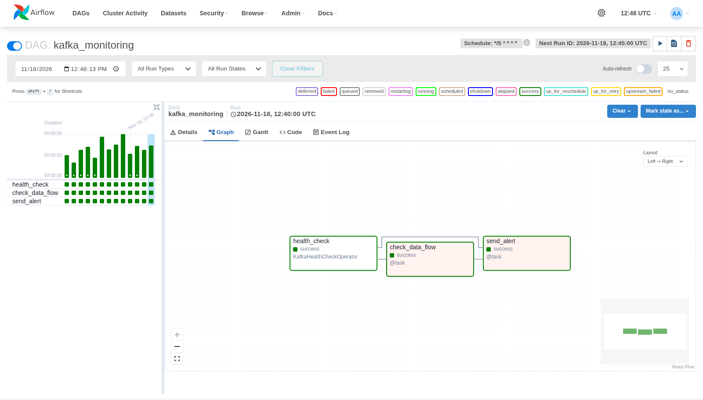
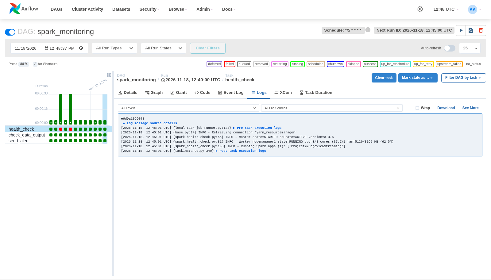

# Data Engineering Coaching Lab: Projects

| Project | Đã làm | Công nghệ |
|---|---|---|
| [spark/99-project](spark/99-project) | Đọc log hành vi người dùng từ Kafka, làm giàu dữ liệu (quốc gia theo IP, browser, OS), lưu vào Postgres theo star schema, dashboard báo cáo | Spark Structured Streaming, Kafka, YARN, Postgres, Streamlit |
| [airflow/99-project](airflow/99-project) | Giám sát pipeline trên: health check Kafka và Spark, kiểm tra dữ liệu output, cảnh báo qua Telegram | Airflow 2.10 (custom operators, TaskFlow), Kafka AdminClient, YARN REST API, WebHDFS, Telegram Bot API |

```
Kafka (product_view) ──> Spark Structured Streaming (YARN) ──> Postgres (fact_page_view) ──> Streamlit
        │                          │ checkpoint (HDFS)                    │
        └──────────── Airflow: kafka_monitoring / spark_monitoring ───────┘ ──> Telegram
```

## Project Airflow: yêu cầu và cách giải quyết

Chi tiết thiết kế, cách chạy: [airflow/99-project/README.md](airflow/99-project/README.md)

### 1. Kafka Monitoring DAG ([`kafka_monitoring`](airflow/99-project/dags/kafka_monitoring.py), chạy mỗi 5 phút)

**Create Kafka HealthCheck Operator** => [`KafkaHealthCheckOperator`](airflow/99-project/plugins/operators/kafka_health_check.py)

| Yêu cầu | Cách làm | Kết quả |
|---|---|---|
| Check broker connectivity | `AdminClient.list_topics()`, không kết nối được => task fail + alert | `Brokers (1)` |
| Verify topic availability | List toàn bộ topic, kiểm tra `product_view` tồn tại, partition có leader, lấy low/high watermark từng partition | `Topics (1): ['product_view']`, 3 partition |
| Monitor consumer group status | List toàn bộ consumer group: state, số member, committed offset (đọc đến đâu), lag. Spark Structured Streaming không commit offset vào Kafka => đọc offset từ checkpoint của job trên HDFS (WebHDFS) | Consumer `spark:Project99PageViewStreaming`, đọc tới batch 35 |

**Implement data flow checks**: so sánh watermark/offset lần chạy này với lần chạy 5 phút trước (lưu ở Airflow Variable)

| Yêu cầu | Cách làm | Kết quả |
|---|---|---|
| Monitor message throughput | high watermark hiện tại - high watermark 5 phút trước | `+2957 message, 590.5 msg/phút` |
| Check consumer lag | high watermark - offset consumer đã đọc | `lag=319` |
| Verify message processing rates | offset consumer hiện tại - offset 5 phút trước | `xử lý +2940 message (587.1 msg/phút)` |
| Set up alerting thresholds | Không có message mới / lag > 10 000 / consumer xử lý < 50% message mới và lag tăng | Phát hiện sự cố thật: `lag tăng 390 -> 3482` |



### 2. Spark Monitoring DAG ([`spark_monitoring`](airflow/99-project/dags/spark_monitoring.py), chạy mỗi 5 phút)

**Create Spark HealthCheck Operator** => [`SparkHealthCheckOperator`](airflow/99-project/plugins/operators/spark_health_check.py)
(Spark chạy trên YARN: master = ResourceManager, worker = NodeManager, đọc qua YARN REST API)

| Yêu cầu | Cách làm | Kết quả |
|---|---|---|
| Check master, worker available | Master state = `STARTED`, đếm worker `RUNNING`, không đủ worker => task fail + alert | `Master: STARTED`, phát hiện sự cố thật: `0/1 worker RUNNING` |
| Monitor resource (core cpu, ram) of workers | Core / RAM đã dùng và tổng của từng worker, cảnh báo khi > 90% | `CPU 3/8 cores (37.5%), RAM 5120/8192 MB (62.5%)` |
| Check data had been inserted to db | Đếm dòng mới trong `fact_page_view` 5 phút gần nhất (`ingested_at`), không có => alert | `+3240 dòng / 5 phút` |



### 3. Alert System ([`telegram.py`](airflow/99-project/plugins/alert/telegram.py))

| Yêu cầu | Cách làm |
|---|---|
| Set up alerting framework | 2 kênh: `on_failure_callback` cho mọi task (lỗi nghiêm trọng => 🔴 TASK FAILED) và task `send_alert` cuối mỗi DAG (vượt ngưỡng => ⚠️ ALERT kèm số liệu) |
| Telegram: configure bot + sending message to a group | Bot tạo bằng @BotFather, thêm vào group, token + `chat_id` lưu trong Airflow Connection `telegram_alert`, gửi qua Telegram Bot API `sendMessage` |

Ví dụ tin nhắn gửi vào group:

```
⚠️ KAFKA ALERT (1 vấn đề)
- Group spark:Project99PageViewStreaming chỉ xử lý 0/3092 message mới trên product_view, lag tăng 390 -> 3482

Topic product_view: +3092 message, 589.1 msg/phút
Group spark:Project99PageViewStreaming / product_view: lag=3482, xử lý +0 message (0.0 msg/phút)
```

```
🔴 TASK FAILED
DAG: spark_monitoring
Task: health_check
Error: Chỉ có 0/1 worker RUNNING (tối thiểu 1)
```
