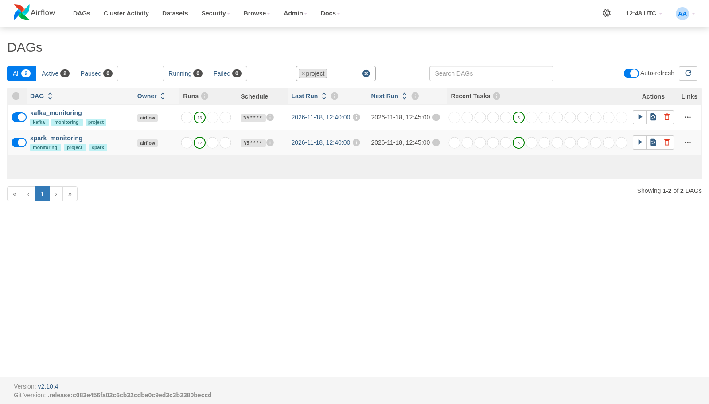
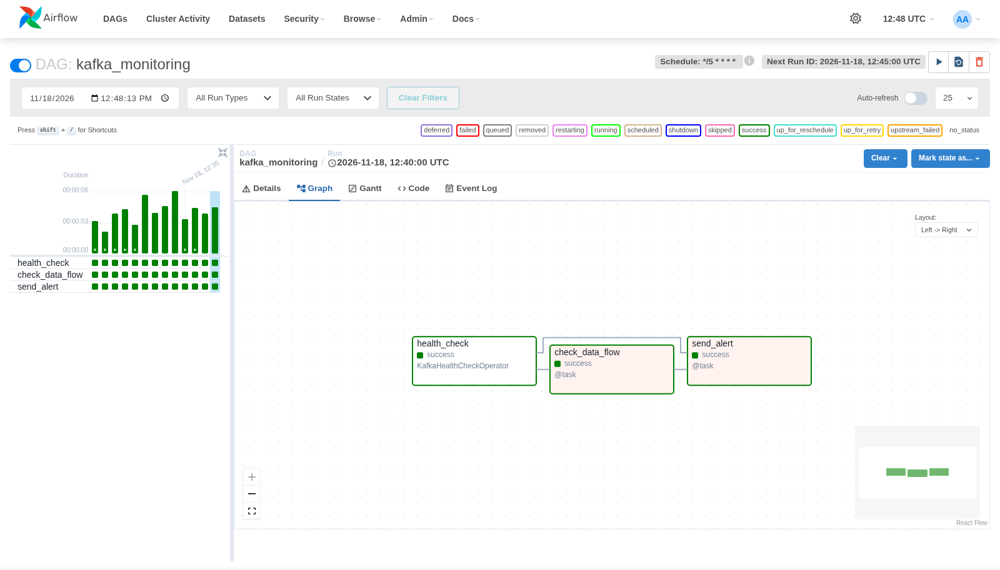
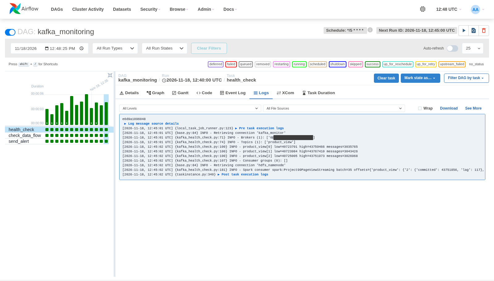
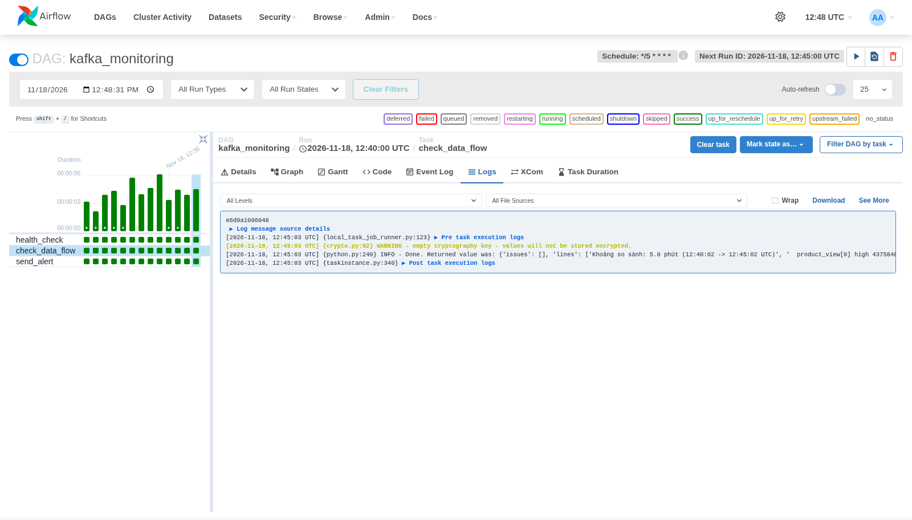
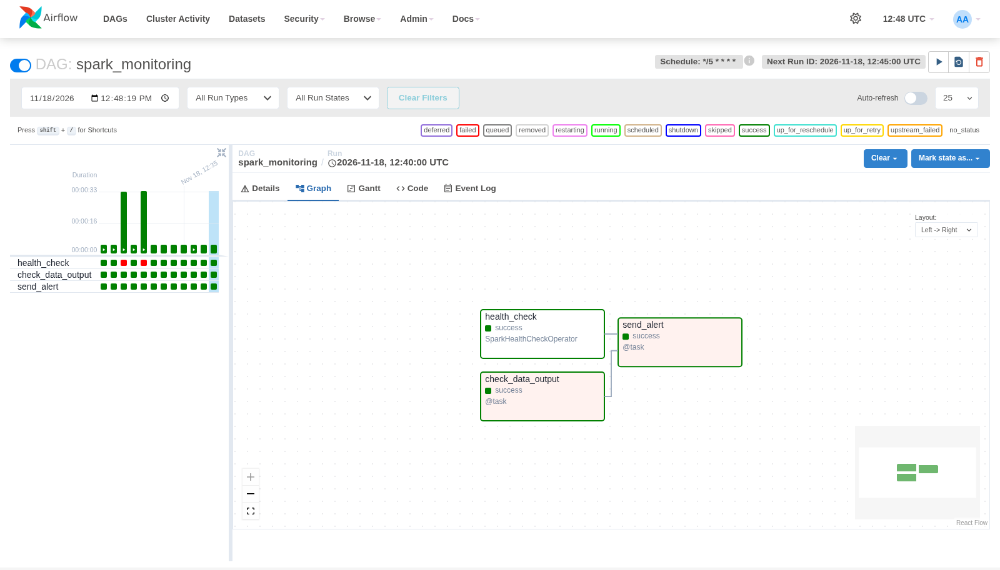
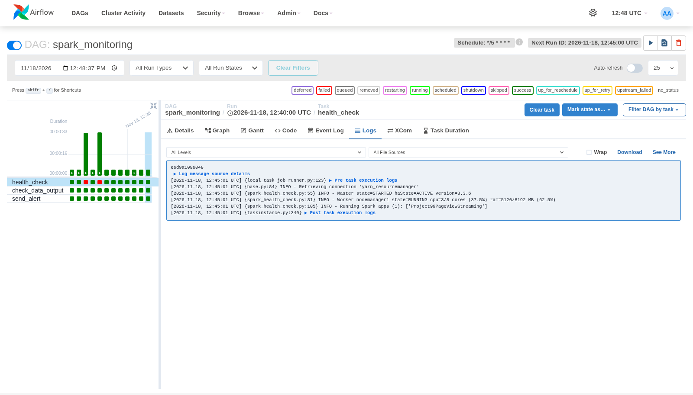

# Project Airflow

## Yêu cầu

### 1. Kafka Monitoring DAG

**Health Check Implementation**

- [x] Create Kafka HealthCheck Operator
    - Check broker connectivity
    - Verify topic availability
    - Monitor consumer group status

**Data Flow Monitoring**

- [x] Implement data flow checks
    - Monitor message throughput
    - Check consumer lag
    - Verify message processing rates
    - Set up alerting thresholds

### 2. Spark Monitoring DAG

**Health Check Implementation**

- [x] Create Spark HealthCheck Operator
    - Check master, worker available
    - Monitor resource (core cpu, ram) of workers

**Check data output**

- [x] Check data had been inserted to db

### 3. Alert System

**Alert Configuration**

- [x] Set up alerting framework
    - Set up Telegram notifications (configure bot + sending message to a group)

## Hạ tầng được giám sát

| Thành phần | Chi tiết |
|---|---|
| Kafka | Broker chung của lớp `<KAFKA_BROKER>` (SASL_PLAINTEXT), topic `product_view` |
| Spark | Job streaming [spark/99-project](../../spark/99-project) chạy trên YARN: master = `resourcemanager`, worker = `nodemanager1` |
| Database | Postgres container `postgres`, bảng `fact_page_view` |
| Alert | Bot Telegram `@dyo_airflow_alert_bot` gửi tin nhắn vào group "Airflow Alerts" |

## Cấu trúc thư mục

```
99-project/
├── dags/                                 # mount vào /opt/airflow/dags/project
│   ├── kafka_monitoring.py
│   └── spark_monitoring.py
└── plugins/                              # mount vào /opt/airflow/plugins/project
    ├── operators/
    │   ├── kafka_health_check.py         # KafkaHealthCheckOperator
    │   └── spark_health_check.py         # SparkHealthCheckOperator
    └── alert/
        └── telegram.py                   # send_telegram_message, telegram_failure_callback
```

## Thiết kế

### Alert: 2 kênh

| Kênh | Khi nào | Nội dung |
|---|---|---|
| `on_failure_callback` (mọi task) | Lỗi nghiêm trọng => task fail (broker down, topic không tồn tại, Spark master down, không đủ worker) | 🔴 TASK FAILED + DAG, task, lỗi, link log |
| Task `send_alert` cuối DAG | Vượt ngưỡng (throughput = 0, lag cao, consumer không theo kịp, CPU/RAM cao, không có dữ liệu mới) | ⚠️ ALERT + danh sách vấn đề + số liệu |

Không có vấn đề => không gửi gì (tránh spam mỗi 5 phút). Muốn xem báo cáo đầy đủ: Trigger DAG w/ config
`{"send_report": true}`.

### DAG `kafka_monitoring` (mỗi 5 phút)

```
health_check (KafkaHealthCheckOperator) >> check_data_flow >> send_alert
```

**`health_check`**

1. Broker: `AdminClient.list_topics()` => list broker
2. Topic: list toàn bộ topic, kiểm tra `product_view` tồn tại, partition nào không có leader
3. Partition offset: low/high watermark từng partition (`AdminClient.list_offsets`)
4. Consumer group: list toàn bộ group, state, số member, committed offset => đã đọc đến đâu, lag
5. Spark consumer: Spark structured streaming **không commit offset vào Kafka** (không hiện trong consumer group)
   mà lưu offset trong checkpoint trên HDFS => đọc `commits/` + `offsets/<batch cuối>` qua WebHDFS để tính lag

Kết quả (snapshot offset) được return => XCom.

**`check_data_flow`** so sánh snapshot lần này với lần chạy trước (lưu ở Variable
`kafka_monitoring_last_snapshot`):

```
Lần 1 (12:00): high watermark p0=1000, p1=2000, p2=3000  -> lưu Variable
Lần 2 (12:05): high watermark p0=1300, p1=2310, p2=3290
=> throughput = (300 + 310 + 290) / 5 phút = 180 msg/phút

consumer lag        = high watermark - offset consumer đã đọc
processing rate     = offset consumer lần 2 - offset consumer lần 1
```

### DAG `spark_monitoring` (mỗi 5 phút)

```
health_check (SparkHealthCheckOperator) ─┐
                                          ├─> send_alert (trigger_rule=all_done)
check_data_output ───────────────────────┘
```

- `health_check`: gọi YARN ResourceManager REST API
    - `/ws/v1/cluster/info`: master state = `STARTED`
    - `/ws/v1/cluster/nodes`: worker RUNNING, core CPU + RAM đã dùng / tổng
    - `/ws/v1/cluster/apps?states=RUNNING`: job `Project99PageViewStreaming` có đang chạy
- `check_data_output`: đếm số dòng mới trong `fact_page_view` 5 phút gần nhất (`ingested_at`)

### Ngưỡng cảnh báo

| Ngưỡng | Giá trị | File |
|---|---|---|
| `MIN_MESSAGES_PER_INTERVAL` | 1 message / 5 phút | `kafka_monitoring.py` |
| `MAX_CONSUMER_LAG` | 10 000 (~17 phút với ~600 msg/phút) | `kafka_monitoring.py` |
| `MIN_PROCESSING_RATIO` | consumer xử lý < 50% message mới **và** lag tăng | `kafka_monitoring.py` |
| `MIN_COMPARE_SECONDS` | 2 lần chạy cách nhau < 120s => không so sánh, giữ mốc cũ (tránh alert sai khi trigger tay) | `kafka_monitoring.py` |
| `MIN_RUNNING_WORKERS` | 1 | `spark_monitoring.py` |
| `MAX_CPU_USAGE_PCT` / `MAX_MEMORY_USAGE_PCT` | 90% | `spark_monitoring.py` |
| `MIN_ROWS_PER_INTERVAL` | 1 dòng / 5 phút | `spark_monitoring.py` |

## Cách chạy

### 1. Khởi động hạ tầng

Hạ tầng (Hadoop/YARN, Postgres, Airflow 2.10 CeleryExecutor) dùng chung network Docker `streaming-network`,
được dựng theo môi trường của khoá học (không kèm trong repo này). Các thay đổi cần làm trên môi trường đó:

**Airflow `docker-compose.yaml`** (trong `x-airflow-common`):

```yaml
volumes:
  - ./99-project/dags:/opt/airflow/dags/project
  - ./99-project/plugins:/opt/airflow/plugins/project
```

và đổi tên service Postgres của Airflow từ `postgres` thành `airflow-postgres` (sửa cả
`AIRFLOW__DATABASE__SQL_ALCHEMY_CONN`, `AIRFLOW__CELERY__RESULT_BACKEND`, `depends_on`) để không trùng hostname
`postgres` với db của project trên `streaming-network`.

**YARN `yarn-site.xml`**: máy dev ổ cứng nhỏ => nâng ngưỡng disk health check lên 98%
(mặc định 90% => `nodemanager1` UNHEALTHY và bị kill container):

```xml
<property>
  <name>yarn.nodemanager.disk-health-checker.max-disk-utilization-per-disk-percentage</name>
  <value>98</value>
</property>
```

### 2. Tạo Telegram bot

1. Chat với `@BotFather`: `/newbot` => lấy token
2. Tạo group, add bot vào group, gửi `/start@<tên bot>` trong group
3. Mở `https://api.telegram.org/bot<TOKEN>/getUpdates` => lấy `chat.id` (số âm) của group

### 3. Tạo Airflow connections

```shell
docker compose exec airflow-worker bash

airflow connections add telegram_alert --conn-type http --conn-host https://api.telegram.org \
  --conn-password '<BOT_TOKEN>' --conn-extra '{"chat_id": "<CHAT_ID>"}'
airflow connections add kafka_monitor --conn-type kafka --conn-extra '{"bootstrap.servers": "<KAFKA_BROKER>",
  "security.protocol": "SASL_PLAINTEXT", "sasl.mechanism": "PLAIN", "sasl.username": "<USERNAME>", "sasl.password": "<PASSWORD>"}'
airflow connections add yarn_resourcemanager --conn-type http --conn-host http://resourcemanager --conn-port 8088
airflow connections add hdfs_namenode --conn-type http --conn-host http://namenode --conn-port 9870
airflow connections add project_postgres --conn-type postgres --conn-host postgres --conn-port 5432 \
  --conn-login postgres --conn-password '<PASSWORD>' --conn-schema postgres
```

### 4. Chạy job Spark streaming

Xem [spark/99-project/README.md](../../spark/99-project/README.md), thêm biến môi trường checkpoint trùng với
`SPARK_CHECKPOINTS` trong `kafka_monitoring.py`:

```shell
-e CHECKPOINT_LOCATION=/user/spark/checkpoint/99-project-20261118
```

### 5. Bật DAG

Trên giao diện http://localhost:18080 bật `kafka_monitoring` và `spark_monitoring` (tag `project`).

Test nhanh không cần bật lịch:

```shell
docker compose exec airflow-scheduler airflow dags test kafka_monitoring -c '{"send_report": true}'
docker compose exec airflow-scheduler airflow dags test spark_monitoring -c '{"send_report": true}'
```

**Lưu ý:** sửa code trong `plugins/` cần `docker compose restart` Airflow, sửa `dags/` thì không cần.

## Kết quả

### Kafka: so sánh watermark 2 lần chạy cách nhau 5 phút

```
✅ KAFKA REPORT

Brokers: 0@<KAFKA_BROKER>
Topics: product_view (3 partition)
Khoảng so sánh: 5.2 phút (11:52:22 -> 11:57:32 UTC)
  product_view[0] high 43749144 -> 43750169 (+1025)
  product_view[1] high 43756938 -> 43757941 (+1003)
  product_view[2] high 43741789 -> 43742784 (+995)
Topic product_view: +3023 message, 586.1 msg/phút
```

### Spark: bình thường

```
✅ SPARK REPORT

Master: STARTED
Workers (1):
  nodemanager1 RUNNING: CPU 3/8 cores (37.5%), RAM 5120/8192 MB (62.5%)
Running apps: Project99PageViewStreaming
Bảng fact_page_view: +7 dòng / 5 phút, tổng 828 dòng
```

### Sự cố thật đã phát hiện (18/11/2026)

Ổ cứng host > 90% => YARN đánh dấu `nodemanager1` UNHEALTHY, kill executor của job Spark:

| Thời điểm | DAG | Cảnh báo |
|---|---|---|
| 12:05 | `kafka_monitoring` | Group spark:Project99PageViewStreaming chỉ xử lý 0/3092 message mới, lag tăng 390 -> 3482 |
| 12:07 | `spark_monitoring` | 🔴 TASK FAILED: Chỉ có 0/1 worker RUNNING (tối thiểu 1) |
| 12:24 | `kafka_monitoring` | Lag 14284 (ngưỡng 10000) sau khi job chạy lại, còn tồn đọng message |

### Ảnh chụp

**Danh sách DAG của project**



**DAG `kafka_monitoring`**



`health_check`: list broker, topic, watermark từng partition, consumer group, offset của Spark consumer



`check_data_flow`: so sánh với lần chạy 5 phút trước => throughput, lag, tốc độ xử lý



**DAG `spark_monitoring`** (2 ô đỏ = 2 lần phát hiện worker UNHEALTHY do ổ cứng đầy)



`health_check`: master state, worker CPU/RAM, Spark app đang chạy


